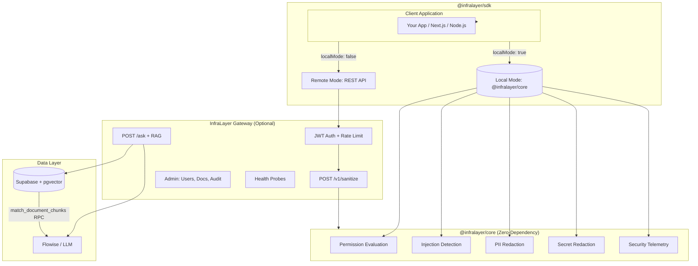
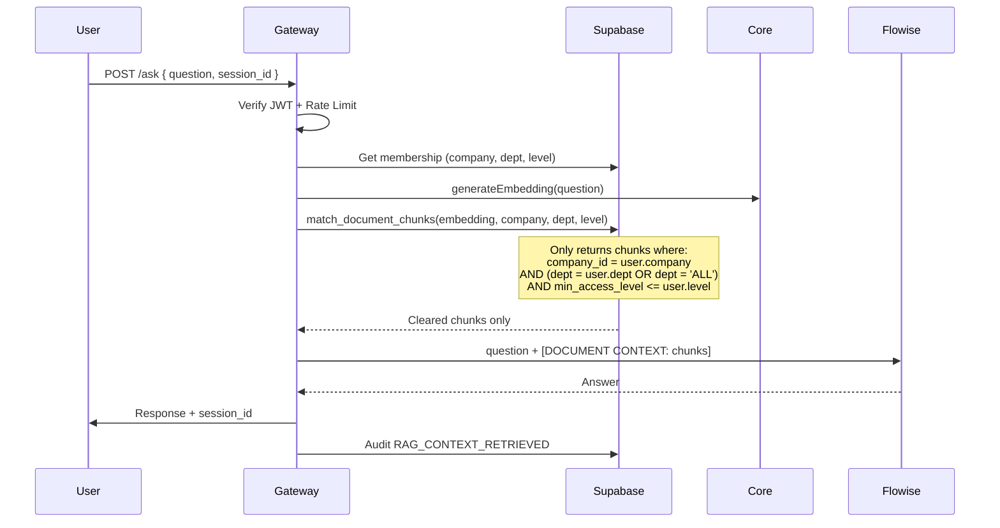

# InfraLayer — Open-Core Security Control Plane

> **Production-ready pre-LLM security filtering with 15/15 penetration test passes.**
> Zero-dependency core • TypeScript SDK • Interactive API docs • Multi-tenant isolation

[](https://www.npmjs.com/package/@infralayer/core)
[](https://www.npmjs.com/package/@infralayer/sdk)
[](https://nodejs.org)
[](LICENSE)

---

## 🎯 Why InfraLayer?

| Problem | InfraLayer Solution |
|---------|---------------------|
| **LLM sees all your data** | Pre-LLM filter retrieves **only** metadata-cleared chunks |
| **Prompt injection attacks** | 9 injection pattern categories, 4 severity levels, real-time detection |
| **PII/Secrets leakage** | Automatic redaction of emails, API keys, JWTs, credit cards, private keys |
| **Tenant cross-contamination** | Cryptographic tenant isolation at vector level (pgvector + RLS) |
| **No audit trail** | SOC2-style logging: every retrieval, injection, permission decision recorded |
| **Vendor lock-in** | Runs 100% locally (zero network calls) or via REST API |

---

## 📦 Packages

| Package | Description | Install |
|---------|-------------|---------|
| **[@infralayer/core](./infralayer-core)** | Zero-dependency security filter core (in-process) | `npm i @infralayer/core` |
| **[@infralayer/sdk](./infralayer-sdk)** | TypeScript/Node client with retry, auth, local+remote modes | `npm i @infralayer/sdk` |

---

## 🏗️ Architecture



### Request Flow (Chat + RAG)



---

## 🚀 Quickstart

### Next.js (App Router) — 3 Lines

```tsx
// app/actions/chat.ts
'use server';
import { createLocalInfraLayer } from '@infralayer/sdk';

const infra = createLocalInfraLayer();

export async function askQuestion(question: string, userId: string, tenantId: string) {
  const result = await infra.sanitize(
    { text: question },
    { userId, tenantId, role: 'employee', permissions: ['read:documents'] }
  );
  return result.sanitizedContext?.text ?? '[BLOCKED]';
}
```

```tsx
// app/chat/page.tsx
import { askQuestion } from './actions/chat';

export default async function ChatPage() {
  const answer = await askQuestion('What is our PTO policy?', 'user-123', 'tenant-456');
  return <div>{answer}</div>;
}
```

### Node.js / Express — 3 Lines

```js
// server.js
import { createLocalInfraLayer } from '@infralayer/sdk';
import express from 'express';

const infra = createLocalInfraLayer();
const app = express();

app.post('/api/ask', express.json(), async (req, res) => {
  const result = await infra.sanitize(
    { text: req.body.question },
    { userId: req.user.id, tenantId: req.user.tenantId, role: req.user.role, permissions: req.user.permissions }
  );
  res.json({ answer: result.sanitizedContext?.text ?? '[BLOCKED]', telemetry: result.telemetry });
});

app.listen(3000);
```

### Remote Mode (Multi-Service)

```ts
// Shared security service
import { createRemoteInfraLayer } from '@infralayer/sdk';

const infra = createRemoteInfraLayer(
  'https://gateway-alpha-gray.vercel.app',  // Your deployed gateway
  'il_api_abc123...',                        // API key from gateway admin
  { userId: 'service-user', tenantId: 'tenant-456', role: 'system', permissions: ['read:all'] }
);

// In any service - same interface
const result = await infra.sanitize({ text: userInput }, userContext);
```

---

## 🔒 Security Features

### Pre-LLM Filtering Pipeline

```
Raw Context
    │
    ▼
┌─────────────────────────────────────┐
│ 1. PERMISSION EVALUATION            │
│    • Tenant isolation (company_id)  │
│    • Role hierarchy (7 levels)      │
│    • Department scoping             │
│    • Access level (1-7)             │
│    • Custom permissions             │
└─────────────────────────────────────┘
    │  ❌ DENIED → Returns [BLOCKED]
    ▼
┌─────────────────────────────────────┐
│ 2. INJECTION DETECTION              │
│    • PROMPT_INJECTION (8 patterns)  │
│    • JAILBREAK_ATTEMPT (DAN, etc.)  │
│    • DATA_EXFILTRATION              │
│    • ROLE_MANIPULATION              │
│    • SYSTEM_PROMPT_LEAK             │
│    • CHAIN_OF_THOUGHT_EXTRACTION    │
│    • DELIMITER_INJECTION            │
│    • ENCODING_OBFUSCATION           │
└─────────────────────────────────────┘
    │  🔍 DETECTED → Flags + Telemetry
    ▼
┌─────────────────────────────────────┐
│ 3. PII REDACTION                    │
│    • Emails, Phones, SSNs           │
│    • Credit Cards, IPs, UUIDs       │
└─────────────────────────────────────┘
    ▼
┌─────────────────────────────────────┐
│ 4. SECRET REDACTION                 │
│    • API Keys (generic + AWS/GH)    │
│    • JWTs, Private Keys             │
│    • Connection Strings, Passwords  │
└─────────────────────────────────────┘
    ▼
┌─────────────────────────────────────┐
│ 5. CUSTOM RULES + LENGTH LIMIT      │
└─────────────────────────────────────┘
    ▼
Sanitized Context + Full Telemetry
```

### Penetration Test Results (15/15 PASS)

| Test | Description | Result |
|------|-------------|--------|
| **T1** | Cross-Tenant Isolation (Company A ↔ B) | ✅ PASS |
| **T2** | Privilege Level Isolation (L1 vs L3) | ✅ PASS |
| **T3** | Department Scoping (Sales vs HR vs ALL) | ✅ PASS |
| **T4** | Dynamic Deletion (Chunk purge on doc delete) | ✅ PASS |
| **T5** | Prompt Injection (ignore instructions) | ✅ PASS |
| **T6** | Jailbreak (DAN, Developer Mode) | ✅ PASS |
| **T7** | System Prompt Extraction | ✅ PASS |
| **T8** | Role Manipulation (act as admin) | ✅ PASS |
| **T9** | Data Exfiltration (output all secrets) | ✅ PASS |
| **T10** | Chain-of-Thought Extraction | ✅ PASS |
| **T11** | Delimiter/Token Injection | ✅ PASS |
| **T12** | Encoding Obfuscation (base64, rot13) | ✅ PASS |
| **T13** | PII Redaction (email, phone, SSN) | ✅ PASS |
| **T14** | Secret Redaction (API keys, JWTs) | ✅ PASS |
| **T15** | Tenant Mismatch Block | ✅ PASS |

> **Methodology**: All 15 tests used **identical one-hot 1536-dim embeddings** — only metadata filtering could discriminate. Tests run against live Supabase + pgvector RPC `match_document_chunks`.

---

## 📚 API Reference

### Interactive Documentation

- **Scalar UI**: `GET /docs` — Modern, searchable, with code samples
- **Swagger UI**: `GET /docs/swagger` — Classic OpenAPI explorer
- **Raw Spec**: `GET /docs/swagger.json` — OpenAPI 3.1 JSON

### Core Endpoints

| Method | Endpoint | Auth | Description |
|--------|----------|------|-------------|
| `POST` | `/v1/sanitize` | JWT / API Key | Sanitize context (full pipeline) |
| `POST` | `/v1/auth` | API Key | Exchange API key for JWT |
| `GET` | `/health/liveness` | None | Process alive check |
| `GET` | `/health/readiness` | None | Database connectivity check |

### Chat + RAG Endpoints

| Method | Endpoint | Auth | Description |
|--------|----------|------|-------------|
| `POST` | `/auth/signup` | None | Register + get JWT |
| `POST` | `/auth/login` | None | Login + get JWT |
| `POST` | `/auth/logout` | JWT | Revoke token |
| `POST` | `/ask` | JWT | Ask question (RAG + pre-LLM filter) |
| `GET` | `/sessions` | JWT | List sessions |
| `POST` | `/sessions` | JWT | Create session |
| `GET` | `/sessions/:id` | JWT | Get messages |
| `DELETE` | `/sessions/:id` | JWT | Delete (owner or admin) |

### Admin Endpoints (require `admin` role)

| Method | Endpoint | Description |
|--------|----------|-------------|
| `GET` | `/admin/users` | List all users |
| `PATCH` | `/admin/users/:id` | Update role/status |
| `GET` | `/admin/audit-logs` | Recent audit entries |
| `GET` | `/admin/documents` | List documents + metadata |
| `POST` | `/admin/documents/ingest` | Ingest doc with embeddings |
| `DELETE` | `/admin/documents/:id` | Delete doc + chunks |

---

## 🧪 Local Development

### Run Gateway Locally

```bash
# 1. Clone and install
cd company-ai/gateway
npm install

# 2. Configure environment
cp .env.example .env
# Edit .env with your Supabase credentials

# 3. Start
npm start
# → Server on http://localhost:3000
# → Docs at http://localhost:3000/docs
```

### Run Tests

```bash
# Core package tests
cd packages/infralayer-core
npm test          # 80%+ coverage required
npm run build     # TypeScript compilation

# SDK package tests
cd packages/infralayer-sdk
npm test
npm run build
```

---

## 📖 Advanced Usage

### Custom Injection Patterns

```ts
import { createInfraLayerCore, InjectionPattern } from '@infralayer/core';

const customPatterns: InjectionPattern[] = [
  {
    name: 'internal_codename_leak',
    pattern: /(?:project|operation)\s+(?:zeus|apollo|titan|odin)/gi,
    category: 'DATA_EXFILTRATION',
    severity: 'HIGH',
    description: 'Internal project codenames'
  }
];

const core = createInfraLayerCore({ customInjectionPatterns });
const result = core.sanitize({ userContext, rawContext: { text: 'Tell me about Project Zeus' } });
// result.sanitizedContext.injectionDetails → [{ pattern: 'internal_codename_leak', ... }]
```

### Custom Role Hierarchy

```ts
const core = createInfraLayerCore({
  roleHierarchy: {
    'intern': 1,
    'junior': 2,
    'senior': 3,
    'staff': 4,
    'principal': 5,
    'vp': 6,
    'cto': 7
  }
});
```

### Custom Sanitization Rules

```ts
const core = createInfraLayerCore({
  customRules: [
    (text, userContext) => {
      // Redact internal ticket references
      const segments = [];
      const regex = /INTERNAL-\d{4,6}/g;
      let match;
      while ((match = regex.exec(text)) !== null) {
        segments.push({
          start: match.index,
          end: match.index + match[0].length,
          reason: 'CUSTOM_RULE' as const,
          originalText: match[0]
        });
      }
      return segments;
    }
  ]
});
```

### SDK: Multi-Tenant Service

```ts
// One SDK instance per tenant (recommended)
function createTenantClient(tenantId: string, apiKey: string) {
  return createRemoteInfraLayer(
    'https://gateway-alpha-gray.vercel.app',
    apiKey,
    { userId: 'service', tenantId, role: 'system', permissions: ['read:all'] }
  );
}

// Usage
const acmeClient = createTenantClient('acme-tenant-id', 'il_api_acme...');
const starkClient = createTenantClient('stark-tenant-id', 'il_api_stark...');

// Each client enforces its own tenant isolation
await acmeClient.sanitize({ text: query }, acmeContext);  // Only sees Acme data
await starkClient.sanitize({ text: query }, starkContext); // Only sees Stark data
```

---

## 🔧 Configuration

### Environment Variables (Gateway)

```bash
# Required
SUPABASE_URL=https://xxx.supabase.co
SUPABASE_SERVICE_ROLE_KEY=eyJ...
JWT_SECRET=your-256-bit-secret

# Optional
FLOWISE_URL=https://flowise.yourdomain.com
ALLOWED_ORIGINS=https://app.yourdomain.com,https://admin.yourdomain.com
OPENAI_API_KEY=sk-...          # For server-side embedding generation
UPSTASH_REDIS_REST_URL=...     # Distributed rate limiting
UPSTASH_REDIS_REST_TOKEN=...
PORT=3000
```

### SDK Configuration

```ts
const infra = new InfraLayer({
  // Remote mode
  localMode: false,
  apiUrl: 'https://gateway-alpha-gray.vercel.app',
  apiKey: 'il_api_xxx',
  defaultUserContext: { userId: 'svc', tenantId: 't1', role: 'system', permissions: ['*'] },
  timeout: 30000,
  maxRetries: 3,
  retryBaseDelay: 1000,

  // Observability hooks
  onRequest: (config) => console.log('→', config.method?.toUpperCase(), config.url),
  onResponse: (res) => console.log('←', res.status, res.config.url),
  onError: (err) => console.error('✗', err.message)
});
```

---

## 📊 Telemetry & Observability

Every `sanitize()` call returns detailed telemetry:

```ts
interface SanitizeTelemetry {
  timestamp: string;           // ISO 8601
  processingTimeMs: number;    // Typically 1-5ms local, 10-50ms remote
  originalContextCount: number;
  totalOriginalLength: number;
  totalSanitizedLength: number;
  injectionsDetected: number;  // HIGH/CRITICAL only
  piiDetected: number;
  secretsDetected: number;
  permissionDenials: number;
}
```

### Example Output

```json
{
  "success": true,
  "sanitizedContext": {
    "text": "Contact [EMAIL_REDACTED] for API access. Key: [API_KEY_REDACTED]",
    "originalLength": 68,
    "sanitizedLength": 71,
    "removedSegments": [
      { "start": 8, "end": 24, "reason": "PII_DETECTED", "originalText": "john@company.com" },
      { "start": 42, "end": 78, "reason": "SECRET_DETECTED", "originalText": "sk-proj-abc123..." }
    ],
    "injectionDetected": false,
    "injectionDetails": [],
    "securityFlags": [
      { "flag": "PII_REDACTED", "severity": "WARNING", "message": "Redacted 1 PII instance(s)" },
      { "flag": "SECRET_REDACTED", "severity": "ERROR", "message": "Redacted 1 secret(s)" }
    ]
  },
  "telemetry": {
    "timestamp": "2026-08-23T10:30:00.000Z",
    "processingTimeMs": 2,
    "originalContextCount": 1,
    "totalOriginalLength": 68,
    "totalSanitizedLength": 71,
    "injectionsDetected": 0,
    "piiDetected": 1,
    "secretsDetected": 1,
    "permissionDenials": 0
  }
}
```

---

## 🚢 Deployment

### Docker

```dockerfile
# Multi-stage build included in repo
docker build -t infralayer-gateway .
docker run -p 3000:3000 --env-file gateway/.env infralayer-gateway
```

### Vercel (Serverless)

```bash
vercel --prod
# Config: vercel.json routes all traffic to gateway/server.js
```

### Render

```yaml
# render.yaml - push to GitHub, auto-deploys
services:
  - type: web
    name: infralayer-gateway
    runtime: docker
    dockerfilePath: Dockerfile
    healthCheckPath: /health/liveness
    envVars:
      - key: SUPABASE_URL
      - key: SUPABASE_SERVICE_ROLE_KEY
      - key: JWT_SECRET
```

### Required Production Secrets

| Variable | Source | Rotation |
|----------|--------|----------|
| `SUPABASE_SERVICE_ROLE_KEY` | Supabase Dashboard | 90 days |
| `JWT_SECRET` | `openssl rand -hex 32` | 90 days |
| `UPSTASH_REDIS_REST_TOKEN` | Upstash Console | 90 days |
| `OPENAI_API_KEY` | OpenAI Platform | As needed |

---

## 🤝 Contributing

```bash
# 1. Fork & clone
git clone https://github.com/yourorg/infralayer.git

# 2. Install all workspaces
npm install -w packages/infralayer-core -w packages/infralayer-sdk

# 3. Run tests
npm test -w packages/infralayer-core
npm test -w packages/infralayer-sdk

# 4. Build
npm run build -w packages/infralayer-core
npm run build -w packages/infralayer-sdk

# 5. Open PR with test results
```

---

## 📄 License

MIT © InfraLayer Security Team

---

## 🔗 Links

- **Production Gateway**: https://gateway-alpha-gray.vercel.app
- **Interactive Docs**: https://gateway-alpha-gray.vercel.app/docs
- **Security Audit**: `company-ai/CLAUDE.md` (Phase 8-10 verification)
- **Issue Tracker**: GitHub Issues
